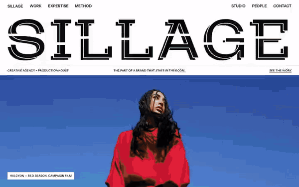

# Free HTML creative agency website template with GSAP scroll animations

Creative agency website template: one free HTML file for an agency or production house, with a manifesto, a filterable portfolio of eight projects, a featured case, services, a four step process, a team and a studio for hire. The look is black and white, with headings in capitals, hairline rules and colour only from the photos. An AGENTS.md travels with the file and tells a coding agent what to keep and what to replace.

[](LICENSE)  

**[Live demo](https://8bsite.github.io/creative-agency-website-template/)** · **[Use this template](https://github.com/new?template_name=creative-agency-website-template&template_owner=8bsite)** · **[Download ZIP](https://github.com/8bsite/creative-agency-website-template/archive/refs/heads/main.zip)** · **[Template page on 8b.com](https://8b.com/templates/sillage/)**

<a href="https://8bsite.github.io/creative-agency-website-template/"></a> <a href="https://8bsite.github.io/creative-agency-website-template/"></a>

<p align="center"><a href="https://8bsite.github.io/creative-agency-website-template/"></a><br><sub>Scroll animation</sub></p>

## Use it with Claude Code, Cursor or Codex

Download the four files into your project folder (`curl.exe` in Windows PowerShell):

```bash
curl -LO https://raw.githubusercontent.com/8bsite/creative-agency-website-template/main/index.html
curl -LO https://raw.githubusercontent.com/8bsite/creative-agency-website-template/main/AGENTS.md
curl -LO https://raw.githubusercontent.com/8bsite/creative-agency-website-template/main/LICENSE
curl -LO https://raw.githubusercontent.com/8bsite/creative-agency-website-template/main/CREDITS.md
```

Then fill in the angle brackets and give your agent this prompt:

```text
Read AGENTS.md, then edit index.html. Turn this template into the site for <my agency or production house: name, what we make, for whom, eight projects each with client, title and discipline, one featured case, services, process, studio space if we rent one, team names and roles, offices, contacts, showreel link>. Replace first the wordmark in the hero and footer, then the projects, client names and team. Keep the section ids and the classes AGENTS.md lists, set each width filling line's length number to its character count, and keep project tags matching the filter buttons. Ask me for missing facts and never invent clients, awards, prices, addresses, headcount or contacts.
```

When you vibe code this file in Claude Code, Cursor or Codex, change the wordmark first. Its letters appear twice, in the hero and in the footer, one span per letter with a data-glyph copy, and the --len number must match the letter count. Next replace the eight projects, the ten client names and the six team members, keeping each project's tags in step with the filter buttons. Do not rename the section ids or the script classes AGENTS.md lists, and keep hero beside manifesto and works beside feature, or those scroll hand-offs switch off. The agent should ask you for clients you may name, headcount, studio specs, addresses and contacts instead of inventing them.

No agent? Click **[Use this template](https://github.com/new?template_name=creative-agency-website-template&template_owner=8bsite)**, edit `index.html` on GitHub and turn on **Settings > Pages**.

## Sections and motion

- **Navigation**: top bar: wordmark, two groups of section links; phone menu overlay with email and phone.
- **First screen**: first screen: width-filling cut wordmark, a ruled info line, a full-bleed campaign photo (demo: SILLAGE). Smooth scrolling runs page-wide; section headings further down slide in from the left, trailing echoes. Scrolling away, the wordmark letters fly apart, streaking black, while the photo zooms.
- **Not what a brand says. What stays in the room.**: four width-filling statement lines, a lead, two paragraphs and a ruled line of six verbs. Tied to scroll, the four width-filling statement lines slide in from alternate sides, then the paragraphs rise from a mask.
- **Selected work**: portfolio: a ruled filter bar over an asymmetric grid of eight projects, plus a reel button. Black and grey plates slide back under each photo as you scroll; filter buttons fade non-matching projects to grey.
- **The Amber Hour**: one featured project on a full-screen stage: tags, giant title, client line, credits, button (demo: The Amber Hour). The stage opens from a centre column to full screen; held while you scroll, the giant title slides in from the right.
- **Houses we keep company with**: a looping row of client names set in the wordmark face. Client names run sideways in a continuous loop that pauses on hover.
- **Five rooms. One roof.**: dark section: a portrait and five ruled service rows, each with a title and tags. Service rows brighten as they cross the screen and fade as they leave, while the portrait slowly zooms in.
- **From first line to last frame**: four numbered process steps as a horizontal storyboard (demo: Write, Build, Shoot, Finish &amp; scale). Pinned, the four steps move sideways as a storyboard, each photo panning and zooming out as its frame enters.
- **Studio Sillage, Montreuil**: a space for hire: large photo, text, five ruled spec rows and a booking button. The photo opens from a thin horizontal slit to full height, and the spec rows wipe in from the left.
- **The people in the room**: team: six portraits with names and roles, and a hiring line. Tied to scroll, six portraits start as a tilted pile in the middle of the top row and deal out to their places.
- **Tell us what should stay**: contact: the main email as a width-filling line, four ruled desks with names, emails, phones, addresses.
- **Footer**: the SILLAGE wordmark again, copyright, social links and the Design: 8B credit. Tied to scroll, the wordmark letters gather from wide apart, their black streaks shrinking to nothing.

## Design

 page background, cuts through the wordmark  
 text, rules, buttons, dark services section  
 secondary text  
 spare light grey for small text, defined in the variables but unused by the demo  
 light rules, grey plates behind photos  
 rules on the dark section

**Mozilla Headline**: light, extra wide capitals filling the width. **Instrument Sans**: bold capital headings, small labels, body (Google Fonts). A twelve-column grid ruled with hairlines: info line, filter bar in cells (sticky on wide screens), service and spec rows, contact desks. Each wordmark letter is cut by a thin white line, with a black copy offset behind. Photos are square-cornered in an asymmetric grid; portraits are black and white.

## Questions

**Does it have a contact form?**  
No. The contact section is a width-filling email address and four desks with names, emails, phones and addresses, and the reel, case and studio buttons open pre-addressed emails. The page sends nothing itself. To collect enquiries in a form, ask your agent to add one wired to Formspree or Netlify Forms.

**Can I use it as a marketing agency website template?**  
Yes, for a creative-led marketing agency. The service rows already carry creative strategy, campaign concepts, social strategy, editorial calendars and launch planning, and the filter buttons cover campaign, social and activation work. It has no pricing and no lead form, so add those yourself if you sell on performance.

**Does it work as a video production company website template?**  
Yes. The work grid has a Film filter, the Request the full reel button opens a pre-addressed email until you point it at a Vimeo or YouTube address, the featured case has room for tags, a client line and four credit lines, and the studio section has five spec rows for a space you hire out. Swap the demo photos for stills from your own shoots.

## Is it the right base?

This base is right when the pitch is taste plus the means to shoot it: a creative agency that also produces film and stills, or a production house with a stage to rent. If you run a brand or digital studio and want enquiries through a form, the [design agency](https://8b.com/templates/onda/) template fits better, since it has a contact form and moves its case studies along a sideways track. One limit to know: the eight project cards are plain list items, not links, so any case study page is yours to add.

## Before you publish

- Replace what is marked `data-8b-placeholder` (social preview image, favicon, email, phone, social) and the invented demo facts; [AGENTS.md](AGENTS.md) lists them.

## Tech

GSAP 3.13.0, ScrollTrigger, Lenis 1.3.27 from jsDelivr, 106 KB, no build step. Chrome and Edge 111+, Safari 16.2+, Firefox 113+ (it uses color-mix(), container query units, cascade layers, small/dynamic viewport units). With "reduce motion" on, the page is complete and still.

## License

MIT, see [LICENSE](LICENSE). Photos, fonts and libraries keep their own licences: [CREDITS.md](CREDITS.md). More free templates: [8b.com/templates](https://8b.com/templates/) · [github.com/8bsite](https://github.com/8bsite).
